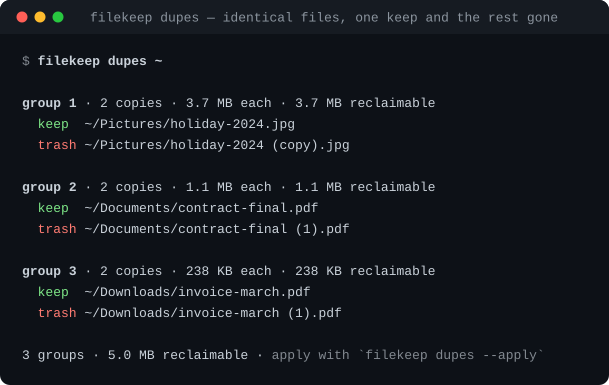

# filekeep

**A file manager for people who live in a terminal.** Index your disk once, then search it
instantly, kill duplicates, see what is eating space, sort the mess into folders — and undo
any of it with one command.

[](https://github.com/tatlisbeyefendi/filekeep/actions/workflows/ci.yml)
[](https://www.python.org/downloads/)
[](LICENSE)
[](#requirements)


```
$ filekeep dupes ~
group 1 · 2 copies · 3.7 MB each · 3.7 MB reclaimable
  keep  ~/Pictures/holiday-2024.jpg
  trash ~/Pictures/holiday-2024 (copy).jpg
```



---

## What it does

- **Index** — one SQLite file remembers every path, size, age, kind and SHA-256 digest.
  Rescans are incremental: unchanged files are never re-hashed.
- **Search** — `ls` and `find` filter by kind, extension, name, glob, regex, size, age or tag.
- **Deduplicate** — `dupes` groups identical files by digest and marks one keeper per group.
- **Understand the disk** — `big`, `usage`, `stale` and `stats` answer "what is taking the
  space" and "what have I forgotten about".
- **Organise** — `organize` sorts files into `Photos/`, `Archives/`, `2026-03/` … and `rename`
  rewrites names from a token pattern.
- **Never lose a file** — every change is a dry run until you pass `--apply`, deletions go to
  filekeep's own trash, and every operation is journaled so `undo` can reverse it.

## Requirements

Python 3.11 or newer. No third-party dependencies — the standard library and SQLite only.
Works on Linux, macOS and Windows.

## Install

```console
$ pipx install git+https://github.com/tatlisbeyefendi/filekeep   # recommended
$ pip install git+https://github.com/tatlisbeyefendi/filekeep
$ uv tool install git+https://github.com/tatlisbeyefendi/filekeep
```

From a checkout:

```console
$ git clone https://github.com/tatlisbeyefendi/filekeep
$ cd filekeep
$ python -m pip install .
```

Both `filekeep` and the short alias `fk` are installed.

## Quick start

```console
$ filekeep scan ~/Downloads ~/Pictures    # index two folders
$ filekeep ls ~/Downloads --sort size     # what is in there, biggest first
$ filekeep dupes ~/Pictures               # what is there twice
$ filekeep big -l 10                      # the ten largest indexed files
$ filekeep stale --older-than 6mo         # untouched since spring
$ filekeep stats                          # totals by kind and year
```

Indexing is safe to repeat: run `filekeep scan ~` whenever you want a fresh picture, or let a
cron job do it every night.

## Safety model

1. **Dry run by default.** `organize`, `rename`, `dupes --apply`, `trash`, `restore` and `undo`
   print what they would do and change nothing until you add `--apply`.
2. **Nothing is deleted.** `dupes --apply` and `trash` move files into
   `~/.local/share/filekeep/trash/<id>/`, recorded in the index so `restore` can put them back
   where they came from.
3. **Every operation is journaled.** `~/.local/share/filekeep/journal.jsonl` records each move,
   rename and trash. `filekeep undo` reverses the last N operations.
4. **Collisions never overwrite.** A second `report.pdf` becomes `report (2).pdf` instead of
   replacing the first one.

## Commands

| Command | What it does |
| --- | --- |
| `scan` | index directories into the database |
| `ls` | list indexed files with filters and sorting |
| `find` | search file names by substring, glob or regex |
| `dupes` | group identical files by SHA-256 and clean them up |
| `big` | the largest indexed files |
| `usage` | disk usage per directory |
| `stale` | files untouched for a long time |
| `organize` | move or copy files into a folder tree by rule |
| `rename` | batch rename with tokens and regex substitution |
| `tag` | attach labels to files and filter by them |
| `trash` | move files into filekeep's trash |
| `restore` | bring trashed files back |
| `undo` | reverse the last operations from the journal |
| `stats` | totals by kind and year |
| `doctor` | check the index for drift and problems |

### Global options

These work before or after the command name.

| Option | Meaning |
| --- | --- |
| `-h`, `--help` | show help for the program or a command |
| `--version` | print `filekeep 0.1.0` and exit |
| `--db PATH` | use a different index file (default `~/.local/share/filekeep/index.db`) |
| `--color {auto,always,never}` | colour output; `auto` follows the terminal and honours `NO_COLOR` |
| `--json` | machine-readable output instead of tables |

### `filekeep scan`

```console
$ filekeep scan ~/Downloads ~/code --hidden --exclude node_modules
```

| Option | Meaning |
| --- | --- |
| `PATH ...` | directories to index; with none, the paths from the previous scan are reused |
| `--hash {auto,always,never}` | `auto` hashes files up to `--max-hash-size`, `always` hashes every size, `never` skips hashing |
| `--max-hash-size SIZE` | size limit for `--hash auto` (default `256MB`) |
| `-j`, `--jobs N` | parallel hashing workers (default 8) |
| `-H`, `--hidden` | include dot files and dot directories |
| `-L`, `--follow-links` | descend into symlinked directories |
| `--exclude NAME` | skip a directory name, repeatable |
| `--no-prune` | keep rows for files that disappeared from disk |

Rescanning prunes rows for deleted files, so the index matches the disk after every run.

### `filekeep ls` / `filekeep find`

```console
$ filekeep ls ~/Pictures --kind image --sort size -l 10
$ filekeep find invoice --glob '*.pdf'
$ filekeep ls --glob '*.py' --newer-than 7d
```

`find PATTERN` is a shortcut for `ls --name PATTERN`; the filters below work for both.

| Option | Meaning |
| --- | --- |
| `PATH ...` | restrict to these directories |
| `--kind KIND` | `image`, `video`, `audio`, `document`, `sheet`, `slides`, `archive`, `code`, `data`, `font`, `app`, `other` (repeatable) |
| `--ext EXT` | match an extension, with or without the dot (repeatable) |
| `--tag TAG` | match a tag, repeatable and combined with AND |
| `--name TEXT` | substring of the file name |
| `--glob PATTERN` | shell-style name pattern |
| `--regex PATTERN` | regular expression on the file name |
| `--path-contains TEXT` | substring of the full path |
| `--min-size SIZE`, `--max-size SIZE` | byte range, accepts `10MB`, `1.5GiB`, `512` |
| `--older-than AGE`, `--newer-than AGE` | age filters, accepts `90s`, `15m`, `12h`, `30d`, `2w`, `6mo`, `1y` |
| `--missing` | include files that vanished from disk |
| `--no-links` | skip symlinks |
| `-v`, `--long` | add a `TAGS` column |
| `--sort {path,name,size,age,kind,ext}` | sort order (`find` defaults to `size`) |
| `-l`, `--limit N` | print at most N rows |
| `-r`, `--reverse` | reverse the sort order (`ls` only) |

### `filekeep dupes`

```console
$ filekeep dupes ~/Pictures                 # dry run: who is a keeper, who goes
$ filekeep dupes ~/Pictures --keep oldest    # keep the oldest copy instead
$ filekeep dupes ~/Pictures --apply          # move the extra copies to the trash
```

| Option | Meaning |
| --- | --- |
| `--keep {newest,oldest,first,shortest-path}` | which copy of each group survives (default `newest`, ties go to the shorter path) |
| `--apply` | really move the extra copies into the trash |
| `--no-hash` | do not hash unhashed candidates (fewer candidates, faster) |
| `--hash-limit N` | hash at most N candidates per run (default 2000) |
| `-l`, `--limit N` | show at most N groups |

Candidates are grouped by size first, then confirmed with a SHA-256 digest, so a group is a
group only when the bytes really match. Files with no digest yet are hashed on the spot.

### `filekeep big` / `filekeep usage` / `filekeep stale`

```console
$ filekeep big -l 20                        # largest files, all kinds
$ filekeep usage ~/Pictures --depth 2       # which folders are heavy
$ filekeep stale --older-than 1y --kind video
```

| Option | Meaning |
| --- | --- |
| `-l`, `--limit N` | number of rows (`big` defaults to 20, `usage` to 15, `stale` to 25) |
| `--depth N` | directory depth for `usage` (default 3) |
| `--older-than AGE` | age threshold for `stale` (default `1y`) |

`big` and `stale` accept every `ls` filter as well.

### `filekeep organize`

```console
$ filekeep organize ~/Downloads --by kind --into ~/sorted
$ filekeep organize ~/Downloads --by month --into ~/sorted --apply
$ filekeep organize ~/Desktop --by ext --into ~/sorted --copy --apply
```

| Option | Meaning |
| --- | --- |
| `--by {kind,ext,year,month,first-letter}` | how to bucket the files |
| `--into DIR` | destination root (required) |
| `--copy` | copy instead of move |
| `--apply` | really do it (default is a dry run) |

`kind` produces `Photos/`, `Videos/`, `Music/`, `Documents/`, `Spreadsheets/`, `Presentations/`,
`Archives/`, `Code/`, `Data/`, `Fonts/`, `Apps/`, `Other/`. Files already inside the destination
are left alone. All `ls` filters apply, so you can organise a subset:

```console
$ filekeep organize ~/Downloads --by year --into ~/archive --older-than 1y --apply
```

### `filekeep rename`

```console
$ filekeep rename ~/Pictures --pattern '{year}/{n}-{stem}{ext}' --pad 3
$ filekeep rename ~/Downloads --pattern '{stem}{ext}' --find '^IMG_' --replace 'photo-'
$ filekeep rename ~/Pictures --pattern '{year}/{n}-{stem}{ext}' --pad 3 --apply
```

| Option | Meaning |
| --- | --- |
| `--pattern TEXT` | token template, applied inside each file's own directory unless it is absolute |
| `--find REGEX`, `--replace TEXT` | extra regular-expression substitution on the expanded name |
| `--no-keep-ext` | do not re-attach the original extension |
| `--start N` | first number for the `{n}` token (default 1) |
| `--pad N` | zero-pad width for `{n}` (`--pad 3` gives `007`) |
| `--apply` | rename for real |

Tokens: `{stem}` (name without extension), `{name}` (same as `{stem}`), `{ext}` (extension
without the dot), `{kind}`, `{year}`, `{month}`, `{day}`, `{n}` (sequence), `{parent}` (parent
folder name), `{size}` (bytes). An unknown token is an error, never a silent literal.

### `filekeep tag`

```console
$ filekeep tag add ~/Documents/contract.pdf signed 2026
$ filekeep tag ls
$ filekeep ls --tag signed -v
$ filekeep tag rm ~/Documents/contract.pdf signed
```

Tags live in the index, so they survive rescans and can be combined with any other filter.

### `filekeep trash` / `filekeep restore` / `filekeep undo`

```console
$ filekeep trash ~/Downloads/setup.exe --apply     # move to filekeep's trash
$ filekeep restore --list                          # what is in the trash
$ filekeep restore --last 1 --apply                # put the newest entry back
$ filekeep undo -n 4 --apply                       # reverse the last four operations
```

| Option | Meaning |
| --- | --- |
| `--apply` | perform the operation instead of previewing it |
| `--list` | list trash entries with their ID, size and age |
| `--last N` | act on the N most recent trash entries |
| `ID ...` | act on specific trash entries (`restore 3 7 --apply`) |
| `-n`, `--steps N` | how many journal entries `undo` reverses (default 1) |

### `filekeep stats` / `filekeep doctor`

```console
$ filekeep stats            # totals per kind and per year, with bars
$ filekeep doctor           # is the index still telling the truth?
$ filekeep doctor --strict  # exit 1 when something needs attention
```

`doctor` reports the index location, how old the last scan is, rows whose files were deleted,
broken symlinks, files without a digest, the size of the trash and the number of journaled
operations — the five things that make a file index untrustworthy.

## JSON output

Every command accepts `--json` (`filekeep --json ls` or `filekeep ls --json`) and prints one
object with `tool`, `version` and `command` plus command-specific keys:

```json
{
  "tool": "filekeep",
  "version": "0.1.0",
  "command": "dupes",
  "groups": [
    {"size": 3842112, "copies": 2, "files": ["/home/me/Pictures/a.jpg", "/home/me/Pictures/a (copy).jpg"]}
  ],
  "reclaimable": 3842112
}
```

File objects look like this:

```json
{
  "path": "/home/me/Pictures/a.jpg",
  "name": "a.jpg",
  "kind": "image",
  "ext": "jpg",
  "size": 3842112,
  "mtime": 1735689600.0,
  "hash": "9f2c…",
  "is_link": false,
  "missing": false
}
```

## Recipes

**Nightly index in a cron job**

```cron
0 3 * * *  filekeep scan ~ --hash auto --jobs 2 >/dev/null 2>&1
```

**Free space in one line**

```console
$ filekeep dupes --min-size 1MB --apply && filekeep stats
```

**Find the screenshots from last month**

```console
$ filekeep find screenshot --kind image --newer-than 30d --older-than 1d
```

**Archive everything older than a year, by year**

```console
$ filekeep organize ~/Downloads --by year --into ~/archive --older-than 1y
$ filekeep organize ~/Downloads --by year --into ~/archive --older-than 1y --apply
```

**Audit a backup drive**

```console
$ filekeep --db /tmp/backup.db scan /mnt/backup
$ filekeep --db /tmp/backup.db dupes --kind image
```

## How it works

- A scan walks each root with `os.scandir`, skips hidden entries unless asked, records
  `path, name, ext, kind, size, mtime, is_link` and hashes only files whose size or mtime
  changed. Hashing runs in a thread pool (`hashlib` releases the GIL).
- Everything lands in one SQLite file with indexes on `path`, `size`, `hash`, `kind`, `ext`,
  `mtime` and `root`. Queries are plain SQL built by `filekeep.query.FileFilter`.
- Duplicates are found in two passes: group by size, then confirm with SHA-256. Two files share
  a group only when both match.
- Moves and renames go through one place (`filekeep.fsops`) that creates parents, resolves name
  collisions and writes the journal entry before the index is updated.
- The trash is a folder plus a table: the file moves to `trash/<id>/<name>` and the row keeps the
  original path, so a restore can put it back exactly where it was.

## FAQ

**Does it touch the network?** No. filekeep never talks to the internet and sends no telemetry.

**Does it follow symlinks?** Symlinks are indexed as symlinks (and reported by `doctor` when they
break). Directory symlinks are only descended into with `-L/--follow-links`.

**What happens if I move a file outside filekeep?** `doctor` reports it, and the next `scan`
prunes the row. Use `--no-prune` if you want the index to keep the memory.

**Can I use it on a network drive or external disk?** Yes — point `scan` at the mount and the
index lives locally. Keep a separate database per disk with `--db`.

**Will `--apply` delete anything permanently?** Only `filekeep trash` moves files, and it moves
them into filekeep's own trash where `restore` can find them. Nothing is ever `unlink`ed except
an undo of a copy operation (which removes the copy that was just created).

**Where is the data?** `~/.local/share/filekeep/` (`index.db`, `journal.jsonl`, `trash/`).
Set `FILEKEEP_HOME` or `XDG_DATA_HOME` to move it.

## Development

```console
$ python -m pip install -e '.[dev]'
$ make test        # pytest
$ make lint        # ruff check + format --check
$ make demo        # rebuild docs/demo*.svg from a throw-away tree
```

The suite covers the storage layer, the scanner, the query builder, the planner, the filesystem
operations and the CLI end to end, including undo and trash round-trips.

## License

MIT — see [LICENSE](LICENSE).
