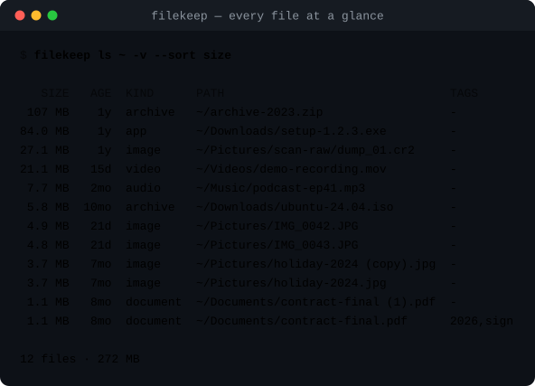

# filekeep

**Terminalde yaşayanlar için dosya yöneticisi.** Diski bir kez indeksle; sonra anında ara,
kopyaları temizle, neyin yer kapladığını gör, dağınıklığı klasörlere ayır — ve hepsini tek
komutla geri al.

[English README](README.md) · [Değişiklikler](CHANGELOG.md) · [Katkı rehberi](CONTRIBUTING.md)



## Ne yapar?

- **İndeksler** — tek bir SQLite dosyası her yolun boyutunu, yaşını, türünü ve SHA-256 özetini
  saklar. Yeniden taramalar artımlıdır: değişmeyen dosyalar yeniden hash'lenmez.
- **Arar** — `ls` ve `find`; tür, uzantı, ad, glob, regex, boyut, yaş ve etikete göre süzer.
- **Kopyaları bulur** — `dupes` aynı içeriğe sahip dosyaları gruplar, her grupta bir tanesini
  "kalsın" diye işaretler.
- **Diski anlatır** — `big`, `usage`, `stale`, `stats`: "yeri ne yiyor", "neyi unuttum".
- **Düzenler** — `organize` dosyaları `Photos/`, `Archives/`, `2026-03/` gibi klasörlere taşır;
  `rename` isimleri token desenine göre yeniden yazar.
- **Dosya kaybettirmez** — her değişiklik `--apply` yazana kadar kuru çalışmadır, silinen
  dosyalar filekeep'in kendi çöp kutusuna gider ve her işlem günlüğe yazılır, `undo` geri alır.

## Gereksinimler

Python 3.11 veya üzeri. Üçüncü parti bağımlılık yok — sadece standart kütüphane ve SQLite.
Linux, macOS ve Windows'ta çalışır.

## Kurulum

```console
$ pipx install git+https://github.com/tatlisbeyefendi/filekeep   # önerilen
$ pip install git+https://github.com/tatlisbeyefendi/filekeep
$ uv tool install git+https://github.com/tatlisbeyefendi/filekeep
```

Depodan:

```console
$ git clone https://github.com/tatlisbeyefendi/filekeep
$ cd filekeep
$ python -m pip install .
```

Kurulumla birlikte `filekeep` ve kısa takma ad `fk` gelir.

## Hızlı başlangıç

```console
$ filekeep scan ~/Downloads ~/Pictures    # iki klasörü indeksle
$ filekeep ls ~/Downloads --sort size     # en büyükten küçüğe listele
$ filekeep dupes ~/Pictures               # iki kere duran ne var
$ filekeep big -l 10                      # en büyük 10 dosya
$ filekeep stale --older-than 6mo         # bahardan beri dokunulmayanlar
$ filekeep stats                          # tür ve yıl bazında toplamlar
```

Tarama tekrar edilebilir; gecelik bir cron işiyle indeksi taze tutabilirsiniz.

## Güvenlik modeli

1. **Varsayılan kuru çalışma.** `organize`, `rename`, `dupes --apply`, `trash`, `restore` ve
   `undo` ne yapacağını yazar, `--apply` ekleyene kadar hiçbir şeyi değiştirmez.
2. **Hiçbir şey silinmez.** `dupes --apply` ve `trash` dosyaları
   `~/.local/share/filekeep/trash/<id>/` altına taşır ve indekse kaydeder; `restore` onları
   geldikleri yere geri koyar.
3. **Her işlem günlükte.** `~/.local/share/filekeep/journal.jsonl` her taşıma, yeniden
   adlandırma ve çöp işlemini yazar. `filekeep undo` son N işlemi geri alır.
4. **Çakışma üzerine yazmaz.** İkinci `rapor.pdf`, birincisinin üzerine yazmak yerine
   `rapor (2).pdf` olur.

## Komutlar

| Komut | Ne yapar |
| --- | --- |
| `scan` | klasörleri veritabanına indeksler |
| `ls` | indekslenen dosyaları süzer ve sıralar |
| `find` | dosya adını alt metin, glob veya regex ile arar |
| `dupes` | aynı dosyaları SHA-256 ile gruplar, temizler |
| `big` | en büyük dosyalar |
| `usage` | klasör bazında disk kullanımı |
| `stale` | uzun süredir dokunulmayan dosyalar |
| `organize` | kuralla klasör ağacına taşır veya kopyalar |
| `rename` | token ve regex ile toplu yeniden adlandırma |
| `tag` | dosyalara etiket ekler, etikete göre süzer |
| `trash` | dosyaları filekeep'in çöpüne taşır |
| `restore` | çöpteki dosyaları geri getirir |
| `undo` | günlükten son işlemleri geri alır |
| `stats` | tür ve yıl bazında toplamlar |
| `doctor` | indeksi tutarlılık için denetler |

Genel seçenekler: `--db PATH`, `--color {auto,always,never}`, `--json`, `--version`, `-h/--help`.

### Örnekler

```console
$ filekeep scan ~/Downloads --hidden --exclude node_modules
$ filekeep ls ~/Pictures --kind image --sort size -l 10
$ filekeep find fatura --glob '*.pdf'
$ filekeep dupes ~/Pictures --keep oldest          # kuru çalışma
$ filekeep dupes ~/Pictures --apply                # kopyaları çöpe at
$ filekeep big -l 20
$ filekeep usage ~/Pictures --depth 2
$ filekeep stale --older-than 1y --kind video
$ filekeep organize ~/Downloads --by kind --into ~/sorted          # kuru çalışma
$ filekeep organize ~/Downloads --by month --into ~/sorted --apply
$ filekeep rename ~/Pictures --pattern '{year}/{n}-{stem}{ext}' --pad 3
$ filekeep tag add ~/Documents/sozlesme.pdf imzali 2026
$ filekeep trash ~/Downloads/setup.exe --apply
$ filekeep restore --list
$ filekeep undo -n 4 --apply
$ filekeep stats
$ filekeep doctor
```

Tüm seçeneklerin ayrıntılı tabloları [İngilizce README'de](README.md#commands) ve
`filekeep <komut> --help` çıktısında.

### rename token'ları

`{stem}`, `{name}`, `{ext}`, `{kind}`, `{year}`, `{month}`, `{day}`, `{n}`, `{parent}`, `{size}`.
Bilinmeyen token sessizce geçilmez, hata verir.

### organize modları

`kind` (Photos, Videos, Music, Documents, Spreadsheets, Presentations, Archives, Code, Data,
Fonts, Apps, Other), `ext`, `year`, `month`, `first-letter`. `--copy` ile kopyalar, `--apply`
ile uygular.

## JSON çıktısı

Her komut `--json` kabul eder ve `tool`, `version`, `command` alanlarıyla birlikte komuta özel
anahtarlar döndürür:

```json
{
  "tool": "filekeep",
  "version": "0.1.0",
  "command": "dupes",
  "groups": [
    {"size": 3842112, "copies": 2, "files": ["/home/me/Pictures/a.jpg", "/home/me/Pictures/a (copy).jpg"]}
  ],
  "reclaimable": 3842112
}
```

## Sık sorulanlar

**Ağa erişiyor mu?** Hayır. filekeep internete çıkmaz, telemetri göndermez.

**Symlink'leri takip ediyor mu?** Symlink'ler symlink olarak indekslenir (kırıksa `doctor`
bildirir). Klasör symlink'lerinin içine yalnızca `-L/--follow-links` ile inilir.

**Dosyayı filekeep dışında taşırsam?** `doctor` farkı söyler, sonraki `scan` satırı temizler.
`--no-prune` ile indeks hatırayı korur.

**Veriler nerede?** `~/.local/share/filekeep/` (`index.db`, `journal.jsonl`, `trash/`).
`FILEKEEP_HOME` veya `XDG_DATA_HOME` ile taşınabilir.

## Geliştirme

```console
$ python -m pip install -e '.[dev]'
$ make test        # pytest
$ make lint        # ruff check + format --check
$ make demo        # docs/demo*.svg dosyalarını gerçek çıktıdan yeniden üretir
```

## Lisans

MIT — [LICENSE](LICENSE).
